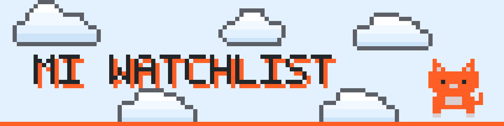
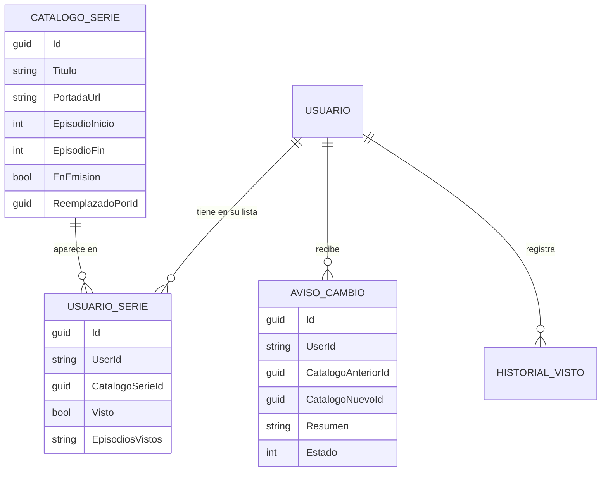
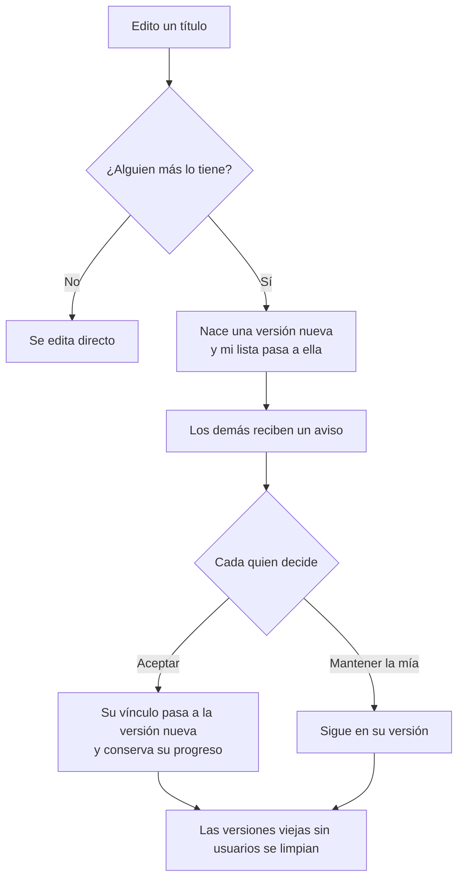
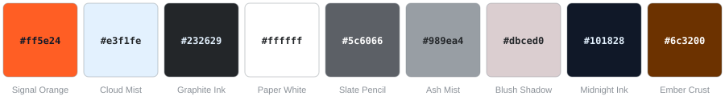

<p align="center">
  <picture>
    <source media="(prefers-color-scheme: dark)" srcset="assets/banner-dark.svg">
    
  </picture>
</p>

<h3 align="center">Lo que ves y lo que lees, en un solo lugar.<br>Con cuentas, un catálogo que comparten todos y estadísticas que sí dicen algo.</h3>

<p align="center">
  
  
  
  
</p>

<p align="center"></p>

## 🐱 La idea

Empezó como una lista de series pendientes guardada en `localStorage` y terminó siendo una aplicación completa:
backend propio, cuentas de usuario, una base de datos donde **un título existe una sola vez** aunque lo tengan cien personas,
y un diseño que no se parece a ninguna plantilla.

Hay tres cosas que la hacen distinta de “otra app de to-do”:

1. **El catálogo es de todos.** Si alguien ya registró *One Piece*, el siguiente usuario lo busca, lo agrega y empieza con su propio progreso en cero.
2. **Las ediciones no pisan a nadie.** Cuando alguien corrige un dato de un título compartido, nace una versión nueva y los demás reciben un aviso para **aceptar el cambio o quedarse con la suya**.
3. **Las estadísticas hablan de hábitos, no solo de totales:** racha, mapa de actividad, qué días ves más, qué estás a punto de terminar.

## 🧭 Qué hay adentro

| | |
|---|---|
| **Series y películas** | Rango de capítulos con checklist por episodio, filtros, búsqueda, orden por avance. Una serie **EN EMISIÓN** tiene día de la semana y fechas de inicio y fin: se dibuja en un calendario semanal o mensual y pasa sola a **FINALIZADO** al terminar el rango o al completar los capítulos. 🎲 *Sorpréndeme* elige algo pendiente sin repetir la última. |
| **Libros, manga y cómics** | Lista con stepper de capítulo y barra de progreso individual cuando hay meta. |
| **Catálogo compartido** | Buscador para agregar un título que ya existe sin llenar el formulario; edición con versiones y campana 🔔 de avisos. |
| **Estadísticas** | Tarjetas de resumen, dos donas, barras proporcionales por tipo, columnas por mes (3, 6 o 12), **tu ritmo** (este mes contra el mes pasado *hasta el mismo día*, racha actual y mejor racha), **mapa de actividad de 12 semanas** en cuadritos, actividad por día de la semana, los más vistos del mes y lo que está **por terminar**. |
| **Cuentas** | Registro e inicio de sesión (ASP.NET Core Identity + JWT propio de 30 días). Cada quien ve solo su lista. |
| **Cuidado de los detalles** | Toasts de éxito y error, modal de confirmación propio (nada de `confirm()` del navegador), cambios que **se revierten solos** si el guardado falla, tema claro/oscuro y pantalla de carga con barra de progreso real. |

> **Historial append-only:** cada episodio o capítulo marcado queda registrado con su fecha y nunca se borra, ni siquiera si luego lo desmarcas. Las estadísticas salen de ahí.

<!--
  📸 GALERÍA — descomenta este bloque cuando tengas las capturas en docs/screens/
  (sugeridas: home.png, calendario.png, estadisticas.png, campana-avisos.png, login.png)

<p align="center">
  
  
</p>
<p align="center">
  
  
</p>
-->

<p align="center"></p>

## 🔧 Por dentro

### Un título, muchas listas

El título vive en un **catálogo**; lo que es de cada persona (su progreso) vive en una tabla intermedia. Hay un catálogo para series/películas y otro para libros/manga/cómics, porque sus campos son distintos.



*Compartido:* título, portada, tipo, rango de capítulos y datos de emisión. *Personal:* solo el progreso.

### Qué pasa cuando alguien edita un título compartido



Las versiones son **inmutables**: nadie ve un cambio que no aceptó, y si alguien estropea los datos, la versión anterior sigue existiendo. La versión *más reciente* de un título se conserva aunque nadie la tenga: es justo lo que hace útil al catálogo.
Los avisos **no revelan quién editó**.

<details>
<summary><b>🐛 Bugs reales que me enseñaron algo</b></summary>

<br>

| Lo que pasaba | La causa | Lo que hice |
|---|---|---|
| Aparecían **dos archivos `.db`** y el historial “desaparecía” | La ruta de la base era relativa y cambiaba según desde dónde se ejecutaba | Ruta absoluta con `ContentRootPath` y un log de cuál se usa |
| Un `500` del backend mostraba el toast de **“guardado ✅”** | `PostAsJsonAsync` / `PutAsJsonAsync` **no lanzan excepción** en un 4xx/5xx (a diferencia de `GetFromJsonAsync`) | `ApiHelper.VerificarAsync` + `ApiException` con mensajes listos para mostrar |
| Los toasts existían en el DOM pero **no se veían** | Bootstrap trae una clase `.toast` con `display: none` salvo que tenga `.show` | Renombrar las clases propias a `.notif-*` |
| Libros perdió la etiqueta de tipo | Al pasar a CSS isolation, la regla quedó con alcance solo para Home | Estilos compartidos a un módulo global (`tags.css`) |
| Un círculo negro enorme al arrancar | Los estilos del indicador de carga de la plantilla estaban en el `app.css` original, ya reemplazado | Pantalla de carga propia que usa las variables de progreso de Blazor |
| Riesgo de **mezclar tipos** al mover un enum | SQLite guarda el número, no el nombre: reordenar valores cambia todo en silencio | Script que compara los enums antes de borrar las clases viejas |
| Barras de una gráfica que no eran proporcionales | Ancho calculado sin escala y sin cultura invariante | Ancho = valor / máximo, escrito con `InvariantCulture` |
| Un día de racha “corrido” | El servidor guarda fechas en UTC | Todo el cálculo de ritmo se hace en hora local |

</details>

<p align="center"></p>

## 🎨 Obscura

El diseño sigue un sistema propio con reglas poco comunes, y se respetó hasta donde fue posible:

- **Un solo acento:** el naranja `#ff5e24`. Nada de un segundo color de marca; las categorías de las gráficas se distinguen con grafito y neutros.
- **Un solo naranja relleno por pantalla:** el botón principal. Lo demás es borde, anillo o texto.
- **Jersey 10** (tipografía pixel) **solo desde 36 px**; **Manrope** para todo lo demás.
- **Radio de 6 px** en lo interactivo, 12–16 px en tarjetas y sombras suaves en varias capas.
- **Pixel art plano**: nubes y un gato hechos con cuadrículas reales (SVG con `crispEdges`), sin suavizado ni degradados.

<p align="center"></p>

Dos decisiones propias donde el sistema no decía nada o fallaba: el texto sobre el botón naranja es **`#101828` en lugar de blanco** (contraste 5,8:1 en vez de ~3:1) y los **bordes de los campos de texto** son más marcados que el borde suave del sistema, para llegar al 3:1 que pide WCAG. El tema oscuro es una derivación mía (grafito y naranja).

## ▶️ Correrlo en tu máquina

**Necesitas:** [.NET SDK 8](https://dotnet.microsoft.com/download) y `dotnet-ef` (`dotnet tool install --global dotnet-ef`). Se usan **dos terminales**.

**1 · Backend**

```powershell
# La clave del JWT NUNCA vive en el código ni en appsettings.json (que sí se versiona)
$env:Jwt__Key = "escribe-aqui-una-clave-larga-de-al-menos-32-caracteres"
# permanente (abre una terminal nueva después):  setx Jwt__Key "..."

cd WatchlistApi
dotnet restore
dotnet run            # http://localhost:5250 · aplica las migraciones solo
```

> El doble guion bajo (`Jwt__Key`) es la convención de ASP.NET Core para claves anidadas (`Jwt:Key`). Si falta, el backend no arranca y lo dice en consola.

**2 · Frontend**

```powershell
cd WatchlistApp_Proyect
dotnet restore
dotnet watch run      # el puerto aparece en consola (en desarrollo suele ser http://localhost:5224)
```

Regístrate con cualquier correo: la primera cuenta que se crea **adopta** los datos que existieran antes de que hubiera login.
Si el backend no está corriendo, la app muestra toasts de error en vez de romperse.

Para cambiar el modelo: `dotnet ef migrations add NombreDelCambio` dentro de `WatchlistApi`.

<details>
<summary><b>📁 Estructura del repositorio</b></summary>

<br>

```
Watchlist/
├── WatchlistApi/                    Backend · ASP.NET Core Web API
│   ├── Controllers/                 Auth · Watchlist · Libros · Catalogo · Avisos · Historial
│   ├── Data/                        AppDbContext · limpieza de versiones viejas del catálogo
│   ├── Helpers/
│   ├── Migrations/                  se versiona: es código, no datos
│   ├── Models/                      catálogos, vínculos, avisos, DTOs y enums
│   ├── appsettings.json             Jwt:Key vacío → se llena con la variable Jwt__Key
│   └── Program.cs
├── WatchlistApp_Proyect/            Frontend · Blazor WebAssembly
│   ├── Layout/                      layouts y componentes compartidos (íconos, gráficas, toasts, modales…)
│   ├── Models/  Pages/  Services/
│   └── wwwroot/
│       ├── css/                     tokens.css → módulos (botones, formularios, modales, pixel art…)
│       └── js/  favicon.png  icon-192.png  icon-512.png
├── assets/                          banner, separador y paleta de este README
└── scripts/                         utilidades de una sola vez
```

`*.db` está en `.gitignore`: la base de datos no se sube.

</details>

## 🚧 Lo que falta (y lo que no hace)

Prefiero decirlo yo antes que dejar que alguien lo descubra:

- [ ] **Publicarla.** Pendiente: sacar la URL del backend (hoy fija en `Program.cs`) a configuración por entorno, restringir el CORS (hoy abierto, válido solo en desarrollo) y elegir hosting. Evaluar SQLite frente a PostgreSQL.
- [ ] **Recuperar contraseña.** Hoy, si se olvida, no hay forma de entrar sin tocar la base.
- [ ] **Límite de intentos de login.**
- [ ] **Pruebas automáticas.** Toda la verificación ha sido manual; la primera candidata es comprobar que un usuario no ve ni edita datos de otro.
- [ ] **Eliminar mi cuenta** (al hacerlo, poner en `NULL` el `CreadoPorUserId` de sus títulos).
- [ ] Sincronización en tiempo real (SignalR). Hoy los cambios entre dispositivos se ven al recargar o navegar.
- [ ] Notas personales por título y exportar/importar en JSON.
- [ ] Subir la portada como archivo en lugar de URL (prototipo en pausa).
- [ ] Fechas exactas por episodio en el calendario (hoy es un día fijo por semana).

<p align="center"></p>

<p align="center">
  Hecho por <b>Diego Alberto Aranda Gonzalez</b> · <a href="https://github.com/DiegoAlb09">@DiegoAlb09</a><br>
  Ingeniería en Computación Inteligente · Universidad Autónoma de Aguascalientes
</p>
